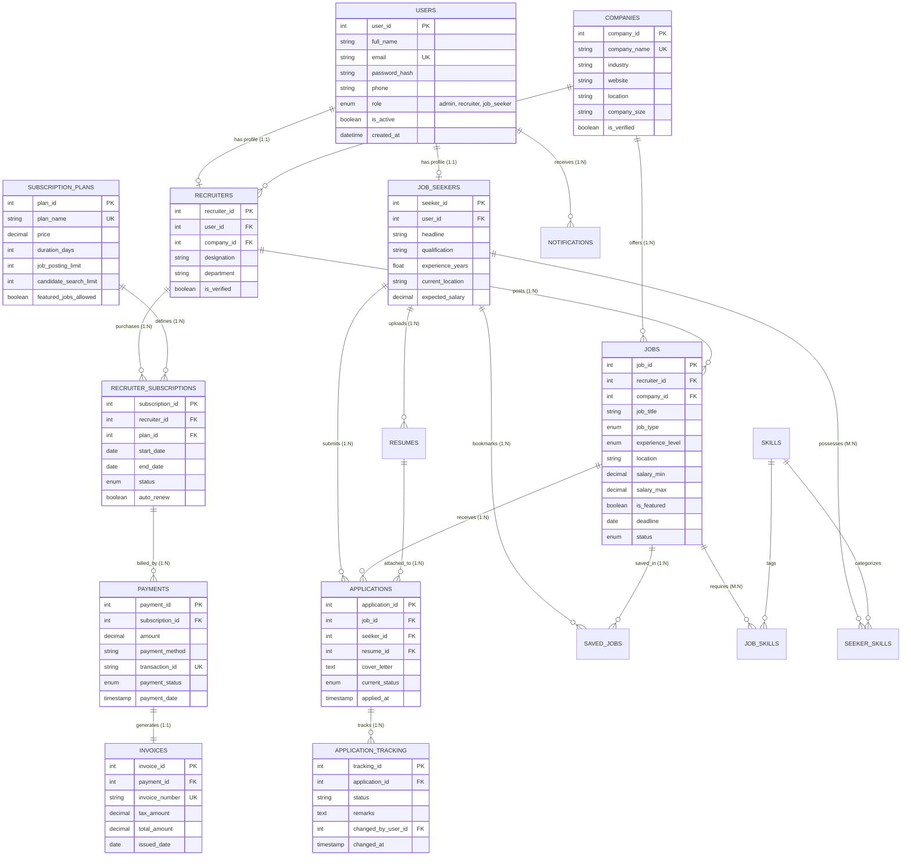

# Online Job Portal Management System with Recruiter Premium Subscription
### Complete Relational Database (SQL) Project & Interactive Dashboard

A normalized, production-ready SQL database management system for a full-stack **Online Job Portal**, built strictly following the 12-module blueprint and ER diagram specification.

---

## 📑 Table of Contents
1. [Core Modules & Database Architecture](#1-core-modules--database-architecture)
2. [Complete Entity-Relationship (ER) Diagram](#2-complete-entity-relationship-er-diagram)
3. [Database Data Dictionary](#3-database-data-dictionary)
4. [Recruiter Premium Subscription Workflow](#4-recruiter-premium-subscription-workflow)
5. [Quickstart Guide (Zero-Setup Engine)](#5-quickstart-guide-zero-setup-engine)
6. [MySQL 8.0+ Production Deployment](#6-mysql-80-production-deployment)
7. [Comprehensive Query Suite Highlights](#7-comprehensive-query-suite-highlights)
8. [Academic & Viva Presentation Notes](#8-academic--viva-presentation-notes)

---

## 1. Core Modules & Database Architecture

The system normalizes information across **15 relational tables** (Third Normal Form - 3NF), covering all 12 modules required:

| # | Module Name | Primary Table(s) | Key Technical Responsibilities |
|---|---|---|---|
| **1** | **User Registration & Login** | `users` | Secure hashed credentials, role-based separation (`admin`, `recruiter`, `job_seeker`), unique email check. |
| **2** | **Job Seeker Management** | `job_seekers` | Bio, education, years of experience, current location, expected CTC. |
| **3** | **Recruiter Management** | `recruiters`, `companies` | Corporate affiliations, verified company profiles, recruiter designations. |
| **4** | **Job Posting & Management** | `jobs` | Vacancies, employment type, salary brackets, expiration deadlines, featured status. |
| **5** | **Job Search & Filtering** | `skills`, `job_skills`, `seeker_skills` | Normalized skills tagging enabling candidate-to-job matching percentages. |
| **6** | **Online Job Applications** | `applications` | `UNIQUE(seeker_id, job_id)` constraint prevents duplicate submissions; links resumes & cover letters. |
| **7** | **Resume Management** | `resumes` | Multi-version resume upload tracking, file paths, file sizes, primary CV selection. |
| **8** | **Application Tracking** | `application_tracking` | Audit history of status milestones: `applied` → `screening` → `shortlisted` → `interview` → `offered`/`rejected`. |
| **9** | **Saved Jobs** | `saved_jobs` | Candidate bookmarks / wishlist for future application. |
| **10** | **Recruiter Premium Subscription** | `subscription_plans`, `recruiter_subscriptions` | Free (₹0), Premium (₹499), Enterprise (₹999) tiers with quota enforcement on job postings. |
| **11** | **Payment Management** | `payments`, `invoices` | Transaction reference IDs (Razorpay simulation), GST calculation (18%), auto-generated tax receipts. |
| **12** | **Notifications & Admin** | `notifications`, analytical views | Trigger-based notifications sent to candidates on status changes; comprehensive Admin KPIs. |

---

## 2. Complete Entity-Relationship (ER) Diagram



---

## 3. Database Data Dictionary

### A. Authentication & Profiles
* **`users`**: Base credentials table. Unique email constraint, role enum (`admin`, `recruiter`, `job_seeker`), and active account toggle.
* **`companies`**: Organization profiles with verification status and industry classification.
* **`job_seekers`**: 1:1 extension of `users` for candidates, containing qualification, years of experience, and expected salary.
* **`recruiters`**: 1:1 extension of `users` for hiring managers, linking them to their respective employer company (`companies`).

### B. Job Postings & Skills
* **`jobs`**: Core vacancy table. Contains recruiter foreign key, salary minimum/maximum (`CHECK(salary_max >= salary_min)`), application deadline, and featured visibility flag.
* **`skills`**: Master taxonomy of technologies (e.g., Python, AWS, SQL, React).
* **`job_skills`**: Composite primary key `(job_id, skill_id)` mapping required skills to job postings.
* **`seeker_skills`**: Composite primary key `(seeker_id, skill_id)` mapping candidate competencies with proficiency levels (`Beginner`, `Intermediate`, `Expert`).

### C. Applications & Audit Timeline
* **`resumes`**: Candidate CV records with storage paths, file sizes, and primary CV indicators.
* **`applications`**: Submitted job applications with unique candidate-job constraint `UNIQUE(seeker_id, job_id)`.
* **`application_tracking`**: Event-sourcing history table recording each status transition with timestamp and reviewer notes.

### D. Subscriptions, Payments & Invoices
* **`subscription_plans`**: Package pricing, posting quotas (2, 10, or 50 jobs), and profile view limits.
* **`recruiter_subscriptions`**: Active and expired plan assignments per recruiter with valid date ranges.
* **`payments`**: Transaction records with simulated gateway response IDs (e.g., `pay_RZP_1001_849201`).
* **`invoices`**: Official billing documents storing 18% GST calculation and gross payable amounts.

---

## 4. Recruiter Premium Subscription Workflow

```
[ Recruiter Logs In ]
        │
        ▼
[ View Current Plan Quota ] ───► Free Plan allows max 2 active jobs
        │
        ▼
[ Select Premium / Enterprise ]
        │
        ▼
[ Process Payment ] ───────────► Razorpay Simulation generates unique Transaction ID
        │
        ▼
[ Verification & DB Trigger ] ─► 1. Status updated to 'active'
                                 2. Invoice generated (INV-YYYY-XXXXX) with 18% GST
                                 3. Posting limit increased to 10 or 50 jobs
                                 4. Featured job badge enabled
```

---

## 5. Quickstart Guide (Zero-Setup Engine)

This project includes a standalone SQLite engine that runs immediately without installing or configuring external database servers.

### Step 1: Initialize the Database and 500-Job Demo Inventory
```bash
python -m pip install -r requirements.txt
python setup_database.py
```
*Creates `job_portal.db`, loads the schema and sample records, adds 500 realistic job listings, checks foreign keys, and prints analytical KPI reports. The launcher also fills in the job inventory on an existing database if it has fewer than 500 jobs.*

### Step 2: Run Unit Tests
```bash
python test_queries.py
```
*Validates constraints, views, and database triggers.*

### Step 3: Launch the Full Web Application
```bash
python run.py
```
Open **`http://localhost:8000`** in your browser. The jobs page shows 24 listings per page; use the visible pagination controls to browse the full inventory. The API documentation is at **`http://localhost:8000/docs`**.

This is a Python application, not a Node.js project; there is no `package.json`, so `npm start` is not a supported startup command. To run the standalone standard-library dashboard instead, use `python server.py`.

The SQLite database is generated locally and is not included in the repository. On first launch, `python run.py` initializes it automatically. GitHub stores the source code; to make the app publicly accessible as a hosted website, deploy it to a Python web host.

Recruiters can open **Manage Applicants** from their dashboard. Accepting and rejecting candidates open dedicated full-page forms for offer details or rejection feedback. Both actions update application history and notify the job seeker.

---

## Deploying to Vercel

This repository is configured for Vercel's Python runtime and FastAPI preset.
Import the repository into a Vercel project; Vercel will install the packages
from `requirements.txt` and use `backend_app:app` as the application entrypoint.
The project root must remain the repository root.

The first API request on a new Vercel function instance creates the sample
database under `/tmp`, including the seeded jobs. Vercel's filesystem is
ephemeral, so database changes are not durable and may differ between function
instances. This deployment is suitable for the demo; use a managed database
and update the database connection code before using it for persistent,
multi-user production data.

For local development, continue to use `python run.py`.

---

## 6. MySQL 8.0+ Production Deployment

To deploy on a live MySQL server:

```bash
# 1. Login to MySQL
mysql -u root -p

# 2. Source the complete schema (Tables, Indexes, Views, Triggers, Stored Procedures)
SOURCE /path/to/online-job-portal-sql/schema.sql;

# 3. Load the comprehensive seed data
SOURCE /path/to/online-job-portal-sql/seed_data.sql;

# 4. Execute analytical queries
SOURCE /path/to/online-job-portal-sql/queries_and_reports.sql;
```

---

## 7. Comprehensive Query Suite Highlights

The project includes 20+ specialized SQL queries in [`queries_and_reports.sql`](file:///C:/Users/Kamal/.gemini/antigravity/scratch/online-job-portal-sql/queries_and_reports.sql):

1. **Smart Candidate Skill Match %**:
   Calculates exact skill alignment between candidate skills and job requirements using relational `JOIN`, `GROUP BY`, and `HAVING`.
2. **Recruiter Job Quota Enforcement**:
   Monitors active jobs versus plan allowances, returning alert flags when limits are reached.
3. **Application Funnel Drop-Off**:
   Aggregates pipeline conversion percentages from initial application to offer letter.
4. **Platform Revenue Summary**:
   Aggregates base subscription revenue, tax collected (18% GST), and gross revenue per tier.
5. **Industry Salary Ranking**:
   Uses window functions (`DENSE_RANK() OVER (PARTITION BY industry ORDER BY salary_max DESC)`) to rank top-compensating roles.

---

## 8. Academic & Viva Presentation Notes

When presenting this project during evaluations:

* **Normalization**: Explain how breaking candidate data into `users`, `job_seekers`, `resumes`, and `seeker_skills` eliminates transitive dependencies and satisfies **3NF**.
* **Referential Integrity**: Highlight `ON DELETE CASCADE` on candidate applications and `ON DELETE RESTRICT` on active subscription plans and companies.
* **Integrity Constraints**: Emphasize `UNIQUE(seeker_id, job_id)` preventing duplicate applications, and `CHECK(salary_max >= salary_min)` preventing invalid salary bands.
* **Triggers & Audit Logging**: Demonstrate `trg_after_application_status_update`, which automatically appends an entry to `application_tracking` whenever an applicant's status changes.
